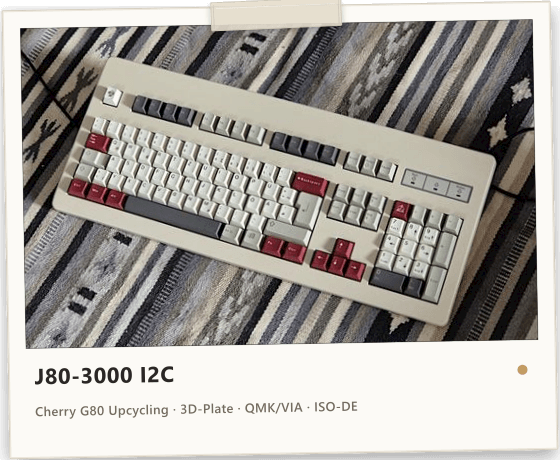
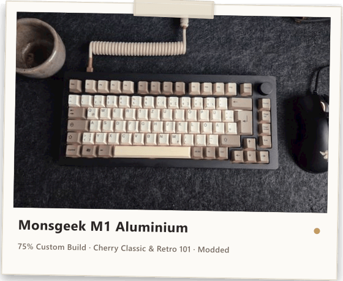
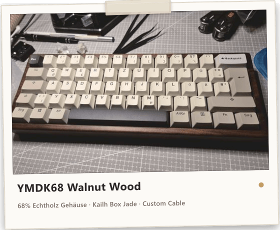
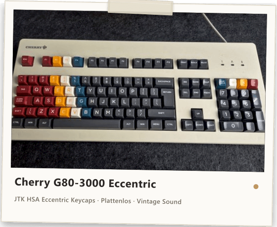

<p align="center">
  <a href="https://brotbeutel.github.io/j-keebs/">
    
  </a>
</p>

<p align="center">
  <a href="https://brotbeutel.github.io/j-keebs/"></a>
  <a href="https://brotbeutel.github.io/j-keebs/keyboards.html"></a>
  <a href="https://brotbeutel.github.io/j-keebs/contact.html"></a>
  
  <a href="https://www.linkedin.com/in/jannik-schl%C3%BCter-103270423/"></a>
</p>

---

### 👋 Hallo, ich bin Jannik (@Brotbeutel)

> **Software-Entwickler & Keyboard-Artisan aus Schwetzingen, Deutschland.**  
> Ich entwickle Web-Anwendungen, erstelle Werkzeuge für die Maker-Community und baue, modde und upcycle mechanische Tastaturen mit kompromisslosem Fokus auf das **deutsche ISO-Layout (ISO-DE)**. Was als Tüfteln an eigenen Tastaturen begann, ist heute eine Werkstatt für Custom-Hardware, Firmware-Hacking und das Restaurieren geschichtsträchtiger Vintage-Boards.

* 📍 **Standort:** Schwetzingen, Baden-Württemberg, Deutschland
* 🌐 **Portfolio & Blog:** [brotbeutel.github.io/j-keebs](https://brotbeutel.github.io/j-keebs/)
* 💼 **LinkedIn:** [linkedin.com/in/jannik-schlüter](https://www.linkedin.com/in/jannik-schl%C3%BCter-103270423/)
* ✉️ **E-Mail:** [jannik_schlueter@hotmail.de](mailto:jannik_schlueter@hotmail.de)

---

### 📸 Meine Werkbank — Ausgewählte Builds (Polaroid-Galerie)

Hier ein Auszug meiner Arbeiten im charakteristischen Polaroid-Stil meiner Website (inklusive Spickzettel-Specs):

<table>
  <tr>
    <td width="50%" align="center" valign="top">
      <a href="https://brotbeutel.github.io/j-keebs/keyboards.html">
        
      </a>
      <br>
      <b>J80-3000 I2C (Cherry G80 Upcycling)</b>
      <br><br>
      <sub>
        <b>Gehäuse:</b> Cherry G80-3000 (Classic Beige) · <b>Plate:</b> 3D-gedruckt<br>
        <b>Elektronik:</b> Komplett neu verdrahtet · <b>Firmware:</b> QMK &amp; VIA<br>
        <b>Custom-Feature:</b> WPM-Visualisierung über I2C-LED-Animation · <b>Layout:</b> ISO-DE
      </sub>
    </td>
    <td width="50%" align="center" valign="top">
      <a href="https://brotbeutel.github.io/j-keebs/keyboards.html">
        
      </a>
      <br>
      <b>Monsgeek M1 Aluminium (75% Custom)</b>
      <br><br>
      <sub>
        <b>Gehäuse:</b> CNC-gefrästes Aluminium (Eloxiert) · <b>Plate:</b> Polycarbonat<br>
        <b>Tastenkappen:</b> Cherry Classic &amp; Retro 101 · <b>Encoder:</b> Rotary Knob<br>
        <b>Mods:</b> Tape-Mod, Custom EVA-Foam, Lubed Switches · <b>Hot-Swap:</b> Ja
      </sub>
    </td>
  </tr>
  <tr>
    <td width="50%" align="center" valign="top">
      <a href="https://brotbeutel.github.io/j-keebs/keyboards.html">
        
      </a>
      <br>
      <b>YMDK68 Walnut Wood (68% Compact)</b>
      <br><br>
      <sub>
        <b>Gehäuse:</b> Massives Walnussholz mit passender Handballenauflage<br>
        <b>Switches:</b> Kailh Box Jade (Taktil &amp; Clicky) · <b>Layout:</b> 68-Key ISO-DE<br>
        <b>Verbindung:</b> Custom USB-C Coiled Cable mit Aviator-Stecker
      </sub>
    </td>
    <td width="50%" align="center" valign="top">
      <a href="https://brotbeutel.github.io/j-keebs/keyboards.html">
        
      </a>
      <br>
      <b>Cherry G80-3000 „Eccentric“ (Vintage Sleeper)</b>
      <br><br>
      <sub>
        <b>Gehäuse:</b> Cherry Originalgehäuse · <b>Mount:</b> Plattenlos (PCB Mount)<br>
        <b>Tastenkappen:</b> JTK HSA Eccentric (High Profile Spherical)<br>
        <b>Akustik:</b> Uriges, sattes Cherry-Klappern – authentisches Retro-Tippgefühl
      </sub>
    </td>
  </tr>
</table>

<p align="center">
  <a href="https://brotbeutel.github.io/j-keebs/keyboards.html"><b>👉 Alle Tastatur-Builds mit interaktiven Spickzetteln im Portfolio entdecken</b></a>
</p>

---

### 🚀 Meine Open-Source-Projekte & Repositories

```
┌─ BROTBEUTEL_REPOS.SYS ────────────────────────────────────────────────────────┐
│                                                                               │
│  [1] j-keebs                  Portfolio-Website (Eleventy 3, Win2k, Gallery)  │
│  [2] Fat-Plate-Generator      Python-Tool für 3D-druckbare Switch-Plates      │
│  [3] Plates-n-Cases           CAD-Designs für Custom-Plates & Gehäuse         │
│  [4] qmk-to-kle-converter     Konverter für QMK-Layouts zu KLE-JSONs          │
│  [5] Keyboard-Hardware-Mgr    Bestands- und Bauteil-Manager für Keyboarder    │
│  [6] qmk_firmware             Eigene QMK-Builds mit deutschen ISO-Features    │
│                                                                               │
└───────────────────────────────────────────────────────────────────────────────┘
```

* **[j-keebs](https://github.com/Brotbeutel/j-keebs)** — Quellcode meines Live-Portfolios: Statische Generierung mit Eleventy 3, Nunjucks, responsiver Bild-Pipeline (WebP `srcset`), client-seitigem DE/EN & Dark/Light Switch sowie dem Windows-2000-Kontaktfenster.
* **[Fat-Plate-Generator](https://github.com/Brotbeutel/Fat-Plate-Generator)** — Generiert extra dicke, formstabile Switch-Plates für den 3D-Druck, optimiert für satten Klang und perfekten Halt von Cherry-MX-kompatiblen Schaltern.
* **[Plates-n-Cases](https://github.com/Brotbeutel/Plates-n-Cases)** — Eigene 3D-CAD-Modelle und Fertigungsdaten für individuelle Tastaturgehäuse und Switch-Plates.
* **[qmk-to-kle-converter](https://github.com/Brotbeutel/qmk-to-kle-converter)** — Wandelt QMK-Firmware-Definitionen in visualisierbare JSON-Daten für den Keyboard Layout Editor (KLE) um.
* **[Keyboard-Hardware-Manager](https://github.com/Brotbeutel/Keyboard-Hardware-Manager)** — Bestands- und Projektverwaltung für Switches, PCBs, Plates und Tastenkappen.
* **[qmk_firmware](https://github.com/Brotbeutel/qmk_firmware)** — Eigener QMK-Fork mit spezifischen Anpassungen für deutsche ISO-DE Tastaturen, Drehregler (Encoder) und I2C-Subsysteme.

---

### 🛠️ Werkbank & Tech-Stack

<table>
  <tr>
    <td width="33%" valign="top">
      <b>💻 Code &amp; Web</b>
      <ul>
        <li>TypeScript / JavaScript (ES6+)</li>
        <li>Node.js</li>
        <li>Eleventy (11ty) v3</li>
        <li>Python 3</li>
        <li>C / C++ (Embedded)</li>
        <li>HTML5 / Semantisches Web</li>
        <li>Vanilla CSS &amp; Design Tokens</li>
      </ul>
    </td>
    <td width="33%" valign="top">
      <b>⌨️ Hardware &amp; Firmware</b>
      <ul>
        <li>QMK Firmware &amp; VIA Config</li>
        <li>RP2040 &amp; ATmega32U4 Microcontroller</li>
        <li>I2C-Bus-Erweiterungen</li>
        <li>Hand-Wiring &amp; Matrix-Bau</li>
        <li>THT- &amp; SMD-Löten</li>
        <li>PCB-Design &amp; Diagnostik</li>
        <li>Deutsches ISO-DE Tastenlayout</li>
      </ul>
    </td>
    <td width="33%" valign="top">
      <b>🔧 Tuning &amp; Fertigung</b>
      <ul>
        <li>FDM 3D-Druck &amp; Slicing</li>
        <li>CAD-Plate-Modellierung</li>
        <li>Lube: Krytox 205g0 / TriboSys</li>
        <li>Stabilizer: XHT-BDZ &amp; Holee-Mod</li>
        <li>Tape-Mod &amp; Gehäusedämpfung</li>
        <li>Vintage Restauration &amp; Retrobright</li>
        <li>Ultraschall-Reinigung</li>
      </ul>
    </td>
  </tr>
</table>

---

### 💬 Vernetzen & Kontakt aufnehmen

<div align="center">
  <p>Lust auf Austausch über deutsche ISO-Layouts, Firmware-Hacks, Modding-Fragen oder gemeinsame Projekte?</p>

  <a href="https://brotbeutel.github.io/j-keebs/contact.html">
    
  </a>
  <a href="mailto:jannik_schlueter@hotmail.de">
    
  </a>
  <a href="https://www.linkedin.com/in/jannik-schl%C3%BCter-103270423/">
    
  </a>
  <a href="https://brotbeutel.github.io/j-keebs/">
    
  </a>
</div>

---

<p align="center">
  <sub>© Jannik Schlüter (@Brotbeutel) · Handcrafted with character in Schwetzingen</sub>
</p>
